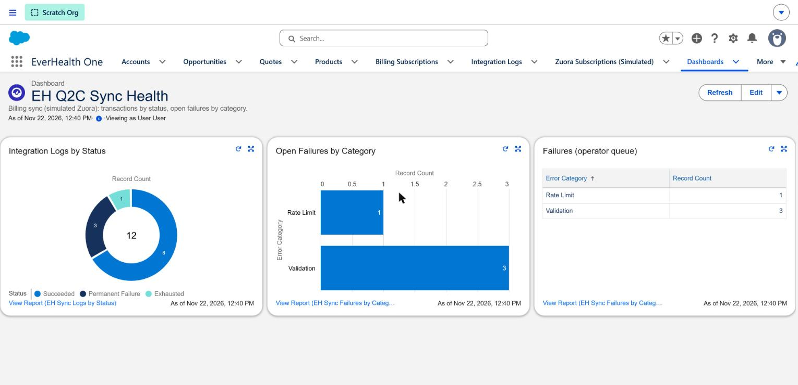
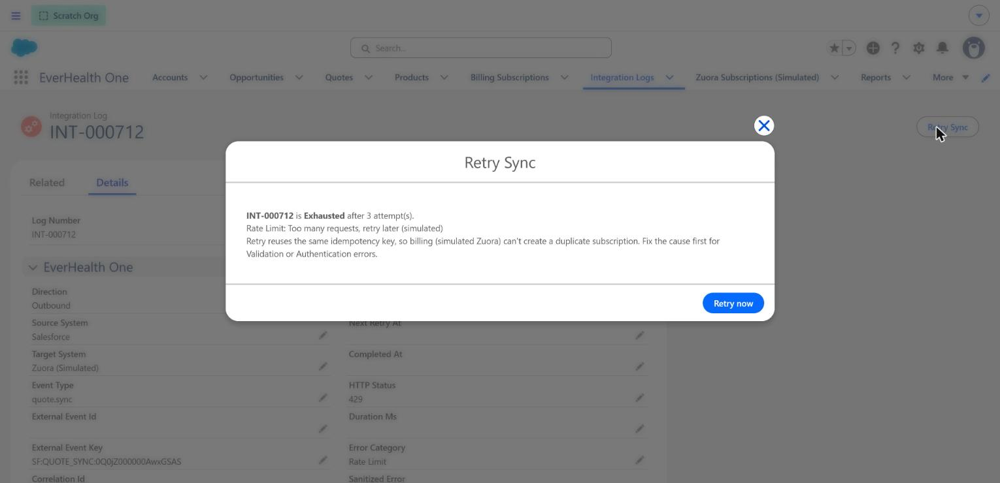
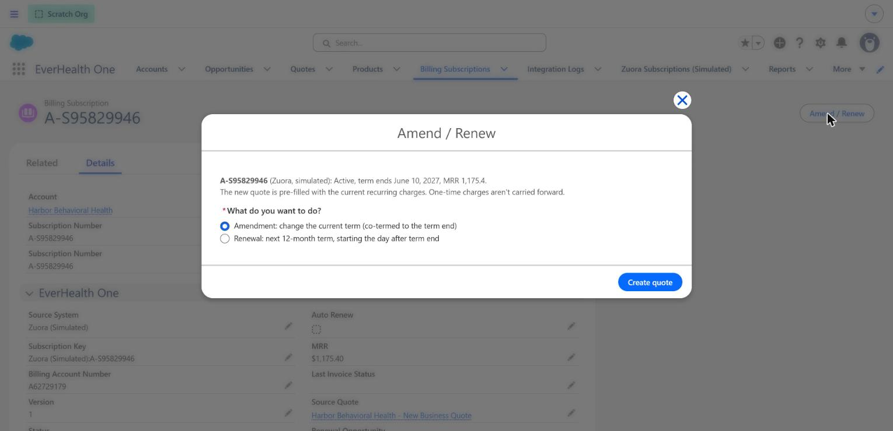
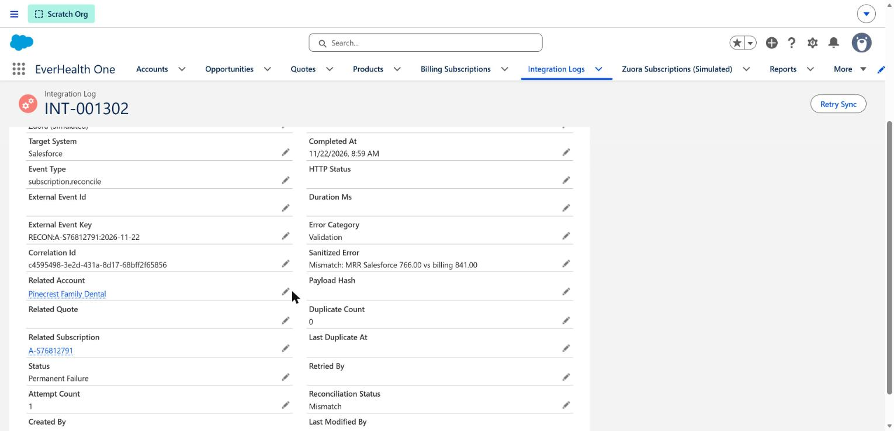
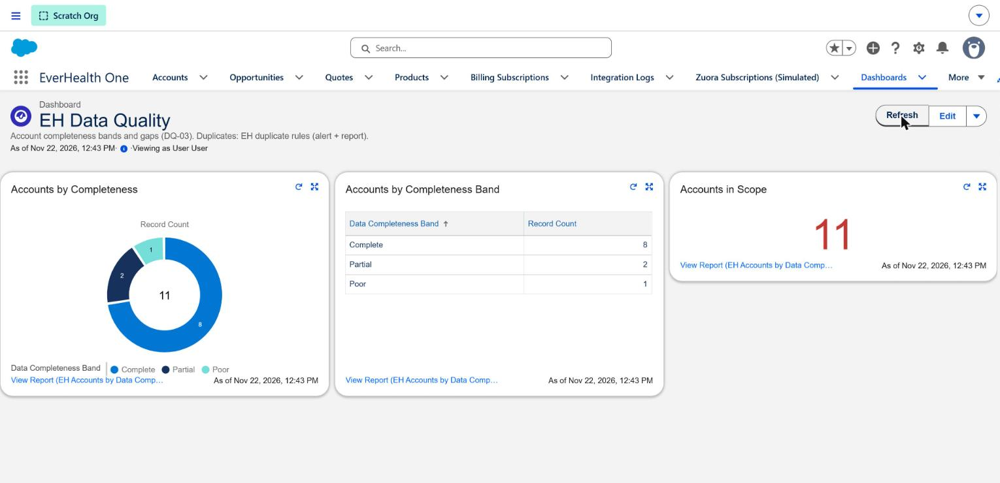
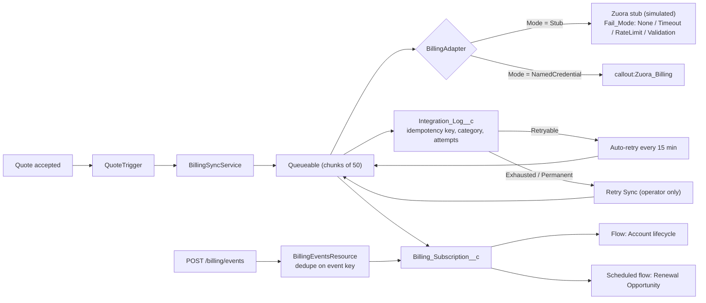

# EverHealth One: Quote-to-Cash & RevOps Control Plane (Salesforce)

A portfolio Salesforce build: Zuora-shaped quoting, an async billing sync that survives failures and duplicates, operator tooling to troubleshoot it, GTM sync rules, data-quality controls, a GitHub + `sf` release process that requires rollback notes, living documentation generated from metadata, and AI-assisted development with guardrails.

> **Fictional and simulated.** Not an EverCommerce product; built without access to any EverCommerce system. **Zuora (CPQ X + Billing), HubSpot, ChurnZero, Gong, Outreach, ZoomInfo and Chili Piper are simulated:** no vendor packages. Synthetic data only: no PHI, no payment data.

## What it shows
| Area | In this repo |
|---|---|
| Quote-to-cash | Zuora-shaped catalog on Product2, quote types New/Amend/Renew, discount approval, renewal Opportunities generated before term end, Amend / Renew action that pre-fills current charges (co-termed amendments) |
| Billing sync + troubleshooting | Async, idempotent sync to a stub billing adapter; Apex REST billing-event intake; **failure switch** in Custom Metadata; categorized Integration Log; bounded auto-retry; operator-only Retry Sync; **daily reconciliation** that flags silent drift vs billing |
| Configuration | Record types, layouts, validation rules, formula + roll-up fields, record-triggered / scheduled / screen flows, approval process |
| Release management | SFDX + GitHub; CI validates deploy, runs tests and Code Analyzer; **PRs without a Rollback section fail**; change-management standard |
| GTM stack | `Field_Mapping__mdt` + sync-rules matrix (direction, winning system, conflict rule, lifecycle mapping) |
| Data quality | Data Loader–format CSVs upserted on external IDs, duplicate rules, completeness score, Data Quality dashboard, bulk-op runbook |
| Living docs | Field inventory **with sensitivity labels**, flow catalog, report index, mapping matrix, all generated; CI fails if stale |
| AI-assisted dev | `CLAUDE.md` guardrails, `/impact`, `/release-notes`, `/metadata-review`, [AI log](docs/AI_LOG.md) |

Full JD traceability: [docs/PRD.md §2](docs/PRD.md#2-jd-traceability).

## Demo video
https://github.com/user-attachments/assets/ee866894-87a4-4950-841e-be9d920c431b

Full-quality file: [video/brag.mp4](video/brag.mp4) (download).

A 1:50 walkthrough of quote-to-cash, amend and renew, billing-sync recovery, data quality and release governance. Each scene names the job-description line it covers. The presenter is AI-generated and the voice is synthetic (Kokoro). The screens are real captures of the scratch org with synthetic data, and Zuora, HubSpot and ChurnZero are simulated. Built with [brag](https://github.com/latent-spaces/brag) and Hyperframes. Music: Sascha Ende, ende.app (CC BY 4.0).

## Screenshots
Synthetic data in a scratch org; Zuora is simulated.

| | |
|---|---|
|  **Q2C Sync Health**: every transaction by status; open failures by category |  **Operator retry** of an exhausted, rate-limited sync (same idempotency key) |
|  **Amend / Renew** from a subscription, pre-filled with current charges |  **Reconciliation** caught a price changed "directly in Zuora" |
|  **Data Quality**: completeness bands |  Fictional brand used on the quote PDF |

## Architecture

Details: [docs/STA.md](docs/STA.md) · data model: [docs/DATA_MODEL.md](docs/DATA_MODEL.md).

## Run it
Prereqs: Salesforce CLI, a Dev Hub, Git Bash (on Windows), Python 3.
```bash
scripts/setup-org.sh eh-demo     # scratch org (30 days) -> deploy -> access -> auto-retry jobs -> demo data
sf org open -o eh-demo           # App Launcher -> "EverHealth One"
```
### Quote template (one manual step)
Quote templates can't be deployed as metadata, so build it once per org (about 5 minutes). The logo and divider images *are* in source (`documents/EH_Branding`, public Documents) and the setup script prints their URLs for your org.
1. Setup → Quote Templates → **New**: name *EverHealth One Quote*, based on *Standard Template*.
2. Header: one-column section with a **Text/Image Field**: Insert Image → Web Address → the **logo** URL; then the line "Billing: Zuora (simulated)"; then Insert Image → the **divider** URL.
3. Line items table: add **Charge Type** and **Billing Period** columns.
4. **Save** → back on the list → **Activate**.

Demo users are created by the script: **Sam Sales** (sales user, can't see or retry integration logs) and **Morgan Manager** (discount approver). Open as either with `sf org open -o <username>`.

## Demo (5–7 minutes)
1. **Quote:** Willow Creek's quote has a 20% discount → pending Morgan's approval (threshold 15% in `Q2C_Setting__mdt`); the validation rule blocks acceptance until approved. Generate the PDF from the template.
2. **Sync:** accept a quote → async sync → the quote shows *Synced* and links a Billing Subscription with a Zuora-style number.
3. **Duplicate event:** `scripts/send-billing-event.sh eh-demo` posts the same billing event twice → first `processed`, then `duplicate` with the same correlation id; the log shows `Duplicate Count = 1`.
4. **Failure + retry:** Northgate's sync is *Exhausted* (rate limited). As an operator: **Retry Sync** → *Succeeded*. As Sam Sales: no access. Or set `Integration_Config__mdt.Zuora_Billing.Fail_Mode__c` = RateLimit and accept a quote to watch a live failure.
5. **Renewals and amendments:** the daily flow (6:00 AM CST) creates Renewal Opportunities for subscriptions ending within 90 days (*EH Renewals Due*). On any subscription, **Amend / Renew** builds an Amendment (co-termed) or Renewal quote pre-filled with the current recurring charges.
6. **Reconciliation:** the daily job flagged Pinecrest: `Mismatch: MRR Salesforce 766.00 vs billing 841.00` (an uplift applied "directly in Zuora"). Edit any record on the *Zuora Subscription (Simulated)* tab, then run `BillingReconciliationJob.run()` from Execute Anonymous to see a new one.
7. **Data quality:** *EH Data Quality* dashboard; create "Lakeside Dental Group" again to see the duplicate alert.
8. **Repo:** `/impact Account.Lifecycle_Stage__c`, [generated field inventory](docs/generated/FIELD_INVENTORY.md), the rollback-note PR check ([script](scripts/check-rollback-note.sh), 8 self-test cases), [AI log](docs/AI_LOG.md).

## Quality
- 60 Apex tests, 97% org-wide coverage (positive, negative, bulk, permission); Code Analyzer with no severity 1–2 findings.
- Script self-tests: rollback-note check (8 cases), doc generator and `/impact` (5 cases).

## Repo map
```text
force-app/main/default/   metadata: objects, classes, triggers, flows, approval, layouts, perm sets, reports, dashboards, CMDT
scripts/                  setup-org.sh, load-demo-data.sh, send-billing-event.sh, seed/*.apex, gen_docs.py, impact.py, check-rollback-note.sh (+ tests)
data/                     Data Loader CSVs (upsert keys: *_Key__c, Billing_Charge_Id__c)
docs/                     PRD, STA, DATA_MODEL, CHANGE_MANAGEMENT, SYNC_RULES, AI_LOG, runbooks/, generated/
.claude/commands/         /impact, /release-notes, /metadata-review
.github/                  CI, rollback-note check, PR template
```

## Docs
[PRD](docs/PRD.md) · [Architecture](docs/STA.md) · [Data model](docs/DATA_MODEL.md) · [Change management](docs/CHANGE_MANAGEMENT.md) · [GTM sync rules](docs/SYNC_RULES.md) · Runbooks: [sync failure](docs/runbooks/zuora-sync-failure.md), [duplicate event](docs/runbooks/duplicate-billing-event.md), [exhausted retry](docs/runbooks/exhausted-retry.md), [rollback & bulk data](docs/runbooks/deploy-rollback-and-bulk-data.md), [reconciliation mismatch](docs/runbooks/reconciliation-mismatch.md) · Generated: [fields](docs/generated/FIELD_INVENTORY.md), [flows](docs/generated/FLOW_CATALOG.md), [reports](docs/generated/REPORT_INDEX.md), [mappings](docs/generated/MAPPING_MATRIX.md)
