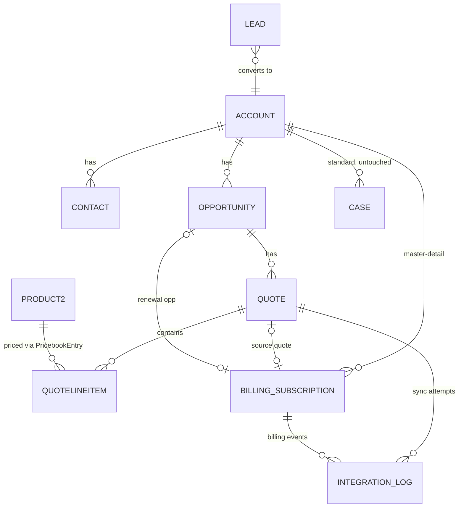

# EverHealth One — Data Model

**Quote-to-Cash & RevOps Control Plane** · v2.0 · 2026-11-22 · Companion to [PRD](PRD.md) and [STA](STA.md)

> Fictional portfolio model. It doesn't reflect EverCommerce systems. **Zuora, HubSpot and ChurnZero are simulated; no vendor packages are installed.** Customers are fictional practice-management SaaS buyers (dental, chiro, PT clinics). **No PHI, no patient data, no payment data**: no fields exist for them. JD traceability is in [PRD §2](PRD.md#2-jd-traceability).

## 1. ERD

Two custom objects (`Billing_Subscription__c`, `Integration_Log__c`), one simulated-vendor object (`Zuora_Subscription_Sim__c`, §3.3) and three Custom Metadata Types. Everything else is standard.

## 2. Standard objects — custom fields
**Sensitivity (Sens.)** = `securityClassification` / `complianceGroup` set on the field. Abbreviations: Pub = Public, Int = Internal, Conf = Confidential, Restr = Restricted.

### Account
| Field | Type | Sens. | Notes |
|---|---|---|---|
| `Account_Key__c` | Text(50), External ID, Unique | Int | Data Loader upsert key |
| `Lifecycle_Stage__c` | Picklist: Prospect, Customer, Former Customer | Int | Set by Flow `EH_Account_Lifecycle_From_Subscription`; mapped to HubSpot lifecycle (SYNC_RULES) |
| `Practice_Type__c` | Picklist: Dental, Chiropractic, Physical Therapy, Behavioral Health, Multi-Specialty | Pub | Segment, not clinical data |
| `Billing_Account_Number__c` | Text(20), External ID, Unique | Conf | Zuora account number (simulated), written back by sync; format `A########` (VR) |
| `HubSpot_Company_Id__c` | Text(30), External ID | Int | Simulated mapping key |
| `ChurnZero_Account_Id__c` | Text(30), External ID | Int | Simulated mapping key |
| `ChurnZero_Health_Score__c` | Number(3,0), read-only on layouts | Conf | Inbound from ChurnZero only (ADR-004) |
| `Data_Completeness__c` | Formula Percent | Int | Share of 5 critical fields filled: Website, Phone, BillingCountry, `Practice_Type__c`, `Lifecycle_Stage__c` |
| `Data_Completeness_Band__c` | Formula Text: Complete (100%) / Partial (≥60%) / Poor | Int | Grouping on the Data Quality dashboard |

### Contact
| Field | Type | Sens. | Notes |
|---|---|---|---|
| `Contact_Key__c` | Text(50), External ID, Unique | Int | Upsert key |
| `HubSpot_Contact_Id__c` | Text(30), External ID | Int / PII | Simulated |
| `Is_Billing_Contact__c` | Checkbox | Int | Bill-to contact sent to billing |

### Lead
| Field | Type | Sens. | Notes |
|---|---|---|---|
| `Lead_Key__c` | Text(50), External ID, Unique | Int | Upsert key |
| `HubSpot_Contact_Id__c` | Text(30), External ID | Int / PII | Simulated |
| `HubSpot_Lifecycle_Stage__c` | Picklist: Subscriber, Lead, MQL, SQL | Int | HubSpot wins until SQL (SYNC_RULES) |
| `Practice_Type__c` | Picklist (same values as Account) | Pub | Maps to Account on conversion |

### Opportunity
Record types (each has its own layout and sales process): **New_Business**, **Amendment**, **Renewal**.

| Field | Type | Sens. | Notes |
|---|---|---|---|
| `Source_Subscription__c` | Lookup(Billing_Subscription__c), delete: Clear | Int | Required for Amendment/Renewal (VR) |
| `Renewal_Key__c` | Text(120), External ID, Unique | Int | `<Subscription_Key__c>:<Term_End_Date__c>`; makes the renewal generator idempotent |

### Quote (standard; Quotes enabled)
| Field | Type | Sens. | Notes |
|---|---|---|---|
| `Quote_Type__c` | Picklist: New, Amend, Renew | Int | Defaulted from the Opp record type by before-save Flow |
| `Term_Months__c` | Number(3,0), default 12 | Int | Sent to billing |
| `Term_Start_Date__c` | Date | Int | Sent to billing |
| `Max_Line_Discount__c` | Roll-up Summary: MAX(QuoteLineItem.Discount) | Conf | |
| `Requires_Discount_Approval__c` | Formula Checkbox: `Max_Line_Discount__c > $CustomMetadata.Q2C_Setting__mdt.Default.Discount_Approval_Threshold__c` | Int | Drives VR `Approval_Required_Before_Accept` (approval entry criteria can't read CMDT) |
| `Approval_Status__c` | Picklist: Not Required, Pending, Approved, Rejected | Int | Set by approval process field updates |
| `Billing_Sync_Status__c` | Picklist: Not Sent, Queued, Synced, Failed | Int | Set by Apex only |
| `Billing_Subscription__c` | Lookup(Billing_Subscription__c), delete: Clear | Int | Written back on success |
| `Last_Sync_Log__c` | Lookup(Integration_Log__c), delete: Clear | Int | Latest attempt |

### QuoteLineItem
| Field | Type | Sens. | Notes |
|---|---|---|---|
| `Charge_Type__c` | Formula Text: `TEXT(Product2.Charge_Type__c)` | Pub | Shown on the Quote Template |
| `Billing_Period__c` | Formula Text: `TEXT(Product2.Billing_Period__c)` | Pub | Shown on the Quote Template |

### Product2 (Zuora-shaped catalog)
| Field | Type | Sens. | Notes |
|---|---|---|---|
| `Charge_Type__c` | Picklist: One-Time, Recurring, Usage | Pub | |
| `Charge_Model__c` | Picklist: Flat Fee, Per Unit, Tiered | Pub | |
| `Billing_Period__c` | Picklist: Month, Quarter, Annual | Pub | Blank for One-Time (VR) |
| `Unit_Of_Measure__c` | Text(30) | Pub | e.g. Provider, Location |
| `Billing_Charge_Id__c` | Text(64), External ID, Unique | Int | Zuora product rate plan charge ID (simulated); upsert key |

Case is standard and has no changes.

## 3. Custom objects

### 3.1 Billing_Subscription__c
Salesforce summary of a subscription owned by Zuora (simulated). Read-mostly: only `EH_Integration_API` and Apex write to it. **No payment data**: no card, bank, token, balance or invoice amount fields.

| Field | Type | Sens. | Notes |
|---|---|---|---|
| `Name` | Text(80) | Int | Subscription number, e.g. `A-S00000123` |
| `Account__c` | Master-Detail(Account) | Int | Sharing: Controlled by Parent |
| `Source_System__c` | Picklist: Zuora (Simulated) | Int | |
| `Subscription_Number__c` | Text(50) | Int | Zuora subscription number |
| `Subscription_Key__c` | Text(120), External ID, **Unique** | Int | `<Source_System__c>:<Subscription_Number__c>`; upsert key (fixes v1 "unique where feasible") |
| `Billing_Account_Number__c` | Text(20) | Conf | Zuora account number |
| `Version__c` | Number(4,0) | Int | Zuora subscription version (amendments increment it) |
| `Status__c` | Picklist: Draft, Pending Activation, Active, Suspended, Cancelled, Expired | Int | Zuora-shaped |
| `Term_Type__c` | Picklist: Termed, Evergreen | Int | |
| `Term_Start_Date__c` / `Term_End_Date__c` | Date | Int | VR: end ≥ start |
| `Auto_Renew__c` | Checkbox | Int | |
| `MRR__c` | Currency(16,2) | Conf | Summary from billing; not a ledger |
| `Last_Invoice_Status__c` | Picklist: Draft, Posted, Cancelled, Error | Conf | Status only, no amount |
| `Source_Quote__c` | Lookup(Quote), delete: Clear | Int | Originating quote |
| `Renewal_Opportunity__c` | Lookup(Opportunity), delete: Clear | Int | Set by renewal generator |
| `External_Updated_At__c` | Date/Time | Int | Event timestamp; older events are ignored (out-of-order protection) |
| `Last_Synced_At__c` | Date/Time | Int | |
| `Last_Sync_Log__c` | Lookup(Integration_Log__c), delete: Clear | Int | |

### 3.2 Integration_Log__c
One record per logical transaction (outbound quote sync or inbound event). Retries update the same record. OWD Private; only operators and admins can read. Lookups use delete = Clear so logs outlive business records.

| Field | Type | Sens. | Notes |
|---|---|---|---|
| `Name` | Auto Number `INT-{000000}` | Int | |
| `Direction__c` | Picklist: Outbound, Inbound | Int | |
| `Source_System__c` / `Target_System__c` | Picklist: Salesforce, Zuora (Simulated) | Int | |
| `Event_Type__c` | Text(80) | Int | `quote.sync`, `subscription.created`, `invoice.posted`, … |
| `External_Event_Id__c` | Text(150) | Int | Source event ID (inbound) |
| `External_Event_Key__c` | Text(255), External ID, **Unique** (case-sensitive) | Int | Idempotency key: `SF:QUOTE_SYNC:<QuoteId>` or `<source>:<eventId>` |
| `Correlation_Id__c` | Text(64) | Int | Generated UUID; returned to callers |
| `Related_Account__c` | Lookup(Account) | Int | |
| `Related_Quote__c` | Lookup(Quote) | Int | |
| `Related_Subscription__c` | Lookup(Billing_Subscription__c) | Int | |
| `Status__c` | Picklist: Queued, Processing, Succeeded, Retryable Failure, Permanent Failure, Exhausted, Skipped | Int | |
| `Attempt_Count__c` | Number(3,0), default 0 | Int | |
| `Last_Attempt_At__c` / `Next_Retry_At__c` / `Completed_At__c` | Date/Time | Int | |
| `HTTP_Status__c` | Number(3,0) | Int | Real or simulated |
| `Duration_Ms__c` | Number(10,0) | Int | |
| `Error_Category__c` | Picklist: Timeout, Network, Rate Limit, Server, Validation, Authentication, Unknown | Int | Drives the retry policy (STA §3.4) |
| `Sanitized_Error__c` | Text Area(1000) | **Restr** | Category + short message; never a raw body or token |
| `Payload_Hash__c` | Text(64) | Int | SHA-256 of the payload |
| `Duplicate_Count__c` | Number(5,0), default 0 | Int | Increments on each duplicate delivery |
| `Last_Duplicate_At__c` | Date/Time | Int | |
| `Retried_By__c` | Lookup(User) | Int | Last operator retry |
| `Reconciliation_Status__c` | Picklist: Not Checked, Matched, Mismatch, Resolved | Int | Stretch (SYNC-07) |

### 3.3 Zuora_Subscription_Sim__c (simulated Zuora)
Not Salesforce data: the stub adapter's stand-in for **Zuora's own record**, so reconciliation has something to compare against. Written by `StubBillingAdapter` on create and mirrored from billing events. Editing a record simulates a change made directly in Zuora. OWD Private; operators read, admins edit.

| Field | Type | Sens. | Notes |
|---|---|---|---|
| `Subscription_Number__c` | Text(50), External ID, Unique | Int | Match key |
| `Account_Number__c` | Text(20) | Conf | |
| `Status__c` | Picklist (same values as Billing_Subscription__c) | Int | |
| `Term_End_Date__c` | Date | Int | |
| `MRR__c` | Currency(16,2) | Conf | |
| `Version__c` | Number(4,0) | Int | |

## 4. Custom Metadata Types
| Type | Fields | Records |
|---|---|---|
| `Integration_Config__mdt` | `Is_Active__c`, `Mode__c` (Stub/NamedCredential), `Fail_Mode__c` (None/Timeout/RateLimit/Validation), `Named_Credential__c` (Text), `Max_Attempts__c`, `Base_Backoff_Seconds__c`, `Timeout_Ms__c` | `Zuora_Billing` |
| `Field_Mapping__mdt` | `System__c` (HubSpot/ChurnZero/Gong/Outreach/ZoomInfo/Chili Piper), `SF_Object__c`, `SF_Field__c`, `External_Field__c`, `Direction__c` (Inbound/Outbound/Bidirectional), `Winning_System__c`, `Conflict_Rule__c` (Source Wins / Salesforce Wins / Most Recent / Fill Blank Only / Append Only), `Is_Active__c`, `Notes__c` | ~20 rows, one per mapped field |
| `Q2C_Setting__mdt` | `Discount_Approval_Threshold__c` (Percent), `Renewal_Lead_Days__c` (Number), `Default_Term_Months__c` (Number) | `Default` (15%, 90, 12) |

**Secrets** never go in CMDT. The metadata inventory includes **External Credential `Zuora_Billing_EC`** and **Named Credential `Zuora_Billing`** (only used when `Mode__c = NamedCredential`; no secret is committed; principal credentials are set per org). Stretch: `Bedrock_EC` / `Bedrock` with AWS SigV4.

## 5. Validation rules and formulas
| Object | Rule | Logic |
|---|---|---|
| Quote | `Approval_Required_Before_Accept` | `ISPICKVAL(Status,'Accepted') && Requires_Discount_Approval__c && NOT(ISPICKVAL(Approval_Status__c,'Approved'))` |
| Quote | `Term_Required_On_Accept` | Accepted and (`Term_Months__c` or `Term_Start_Date__c`) blank |
| Opportunity | `Source_Subscription_Required` | Record type Amendment or Renewal and `Source_Subscription__c` blank |
| Product2 | `Usage_Needs_Unit_Model` | Charge Type Usage and Charge Model = Flat Fee |
| Product2 | `Recurring_Needs_Period` | Charge Type Recurring/Usage and Billing Period blank; One-Time and Billing Period not blank |
| Account | `Billing_Account_Number_Format` | Not blank and `NOT(REGEX(Billing_Account_Number__c,'A[0-9]{8}'))` |
| Billing_Subscription__c | `Term_End_After_Start` | `Term_End_Date__c < Term_Start_Date__c` |

**Duplicate rules:** `EH_Account_Duplicate` (Standard Account Matching Rule: name + website/billing address) and `EH_Contact_Duplicate` (Standard Contact Matching Rule: name + email). Action: **alert and report**, don't block, so Data Loader upserts aren't stopped. Dupes show on the Data Quality dashboard via Duplicate Record Sets.

## 6. External IDs and upsert keys (Data Loader)
| Object | Upsert key | Built from |
|---|---|---|
| Account | `Account_Key__c` | Seed key `ACC-0001` |
| Contact | `Contact_Key__c` | `CON-0001`; Account by `Account_Key__c` |
| Lead | `Lead_Key__c` | `LEAD-0001` |
| Product2 | `Billing_Charge_Id__c` | Simulated Zuora charge ID |
| Billing_Subscription__c | `Subscription_Key__c` | `Zuora (Simulated):<Subscription_Number__c>` |
| Opportunity (Renewal) | `Renewal_Key__c` | `<Subscription_Key__c>:<Term_End_Date__c>` |
| Integration_Log__c | `External_Event_Key__c` | `SF:QUOTE_SYNC:<QuoteId>` or `<source>:<eventId>` |

Seed CSVs live in `data/` in Data Loader format, loaded with `sf data import bulk` / `sf data upsert bulk --external-id`. Re-running a load must create 0 new records.

## 7. Seed data
10 Accounts (mixed completeness, 2 deliberate near-duplicates) · 25 Contacts · 15 Leads across HubSpot stages · 6 Products (platform fee Recurring/Flat, per-provider Recurring/Per Unit, e-claims Usage/Tiered, onboarding One-Time, 2 add-ons) with standard Pricebook entries · 12 Opportunities across record types · Quotes in Draft/Approved/Accepted · 8 Billing Subscriptions, 3 with term end inside the renewal window · Integration Logs showing success, retryable failure, permanent failure, exhausted and duplicate. All fictional, emails `@example.com`.

## 8. v1 → v2 defect fixes
| # | v1 defect | v2 fix |
|---|---|---|
| 1 | "Lookup, Unique" (not valid in Salesforce) | Uniqueness only on Text External ID/Unique fields: `Subscription_Key__c`, `External_Event_Key__c`, `Renewal_Key__c`, `*_Key__c` |
| 2 | Account lifecycle picklist had no field | `Account.Lifecycle_Stage__c` defined; custom fields listed for Account, Contact, Lead, Opportunity, Quote, QuoteLineItem, Product2 |
| 3 | Flow and Apex both owned the same process | One owner per process ([STA §4](STA.md#4-automation-ownership-one-owner-per-process)) |
| 4 | "Platform event" mentioned, never defined | Removed; Queueable is enough |
| 5 | Named/External Credential not in inventory | Added (§4) |
| 6 | Subscription uniqueness "where feasible" | `Subscription_Key__c` = Source + Subscription Number, External ID, Unique |

## 9. Backlog (not modeled)
Customer_Health, Customer_Risk, Success_Plan, Success_Action, Usage_Snapshot, Health_Score_Config: **ChurnZero owns health/CS** (ADR-004). Onboarding_Project/Task, Handoff: not in the JD. Renewal_Work: replaced by Renewal Opportunities (ADR-005).
