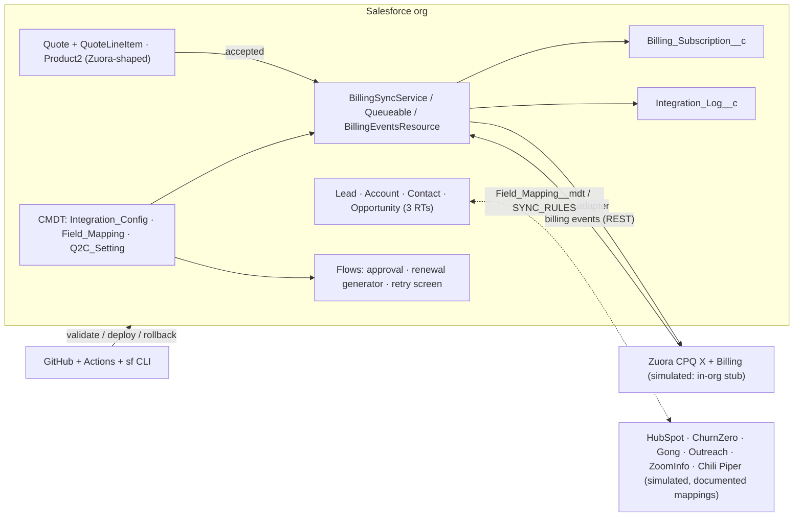
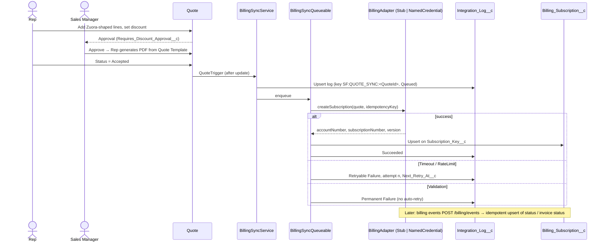

# EverHealth One — Solution & Technical Architecture

**Quote-to-Cash & RevOps Control Plane** · v2.0 · 2026-11-22 · Companion to [PRD](PRD.md) and [Data Model](DATA_MODEL.md)

> Fictional portfolio architecture. It isn't EverCommerce's architecture and wasn't built with access to EverCommerce systems. **Zuora, HubSpot, ChurnZero and the other GTM tools are simulated; no vendor packages are installed.** Synthetic data only: no PHI, no payment data. JD traceability is in [PRD §2](PRD.md#2-jd-traceability).

## 1. Overview

**Principles:** standard objects first · declarative first, Apex where control is needed · one owner per automated process · async integration, never in the save transaction · idempotent by key · config in Custom Metadata, secrets only in Named/External Credentials · every simulation labeled.

## 2. Quote-to-cash sequence

## 3. Integration design

### 3.1 Adapter pattern
`BillingAdapter` (interface) → `StubBillingAdapter` | `HttpBillingAdapter`. `BillingAdapterFactory` picks one from `Integration_Config__mdt` (record `Zuora_Billing`):

| Field | Values | Effect |
|---|---|---|
| `Mode__c` | `Stub` / `NamedCredential` | Stub returns Zuora-shaped responses in-org. NamedCredential calls `callout:Zuora_Billing` (inventory only; unused in the demo) |
| `Fail_Mode__c` | `None` / `Timeout` / `RateLimit` / `Validation` | Stub only: simulates HTTP 504 / 429 / 400 for the live failure demo |
| `Max_Attempts__c` | e.g. 3 | Retry ceiling |
| `Base_Backoff_Seconds__c` | e.g. 60 | Backoff = base × 2^(attempt−1) |
| `Is_Active__c` | checkbox | Off = sync is skipped and logged as `Skipped` |

Swapping the stub for real Zuora changes only the config record and the Named Credential. Callers don't change.

### 3.2 Outbound sync (SF → billing)
1. `QuoteTrigger` (after update, Status changed to Accepted) → `BillingSyncService.enqueue(quoteIds)`, bulk-safe.
2. Upsert one Integration_Log per quote on `External_Event_Key__c = SF:QUOTE_SYNC:<QuoteId>`, so re-accepting or retrying reuses the same record and key.
3. `BillingSyncQueueable` calls the adapter and passes the key as the idempotency key.
4. Success → upsert `Billing_Subscription__c` on `Subscription_Key__c`; update `Quote.Billing_Sync_Status__c`.
5. Failure → `RetryPolicy` categorizes it (table below) and sets `Status__c`, `Error_Category__c`, `Sanitized_Error__c`, `Next_Retry_At__c`.

### 3.3 Inbound billing events (billing → SF)
- **Endpoint:** Apex REST `POST /services/apexrest/billing/events` (`BillingEventsResource`). Authenticated: the caller uses an integration user with `EH_Integration_API`. No guest site. The demo sends events with `sf api request rest`.
- **Events:** `subscription.created`, `subscription.updated`, `subscription.cancelled`, `invoice.posted` (status only, no amounts or payment data).
- **Steps:** validate schema → build key `<source>:<eventId>` → insert the Integration_Log with that unique key. A `DUPLICATE_VALUE` error means it was already processed: return `200 {"status":"duplicate"}` and record the duplicate on the original log (`Duplicate_Count__c`++) → otherwise upsert the subscription → `Succeeded`.

### 3.4 Retry policy
| Category | Source | Auto-retry | Operator retry |
|---|---|:-:|:-:|
| Timeout / Network | 504, CalloutException | Yes, until `Max_Attempts__c` | Yes |
| Rate Limit | 429 | Yes, with backoff | Yes |
| Server | 5xx | Yes | Yes |
| Validation | 400/422 | **No** | Yes, after the data is fixed |
| Authentication | 401/403 | No | Yes, after the credential is fixed |

After the attempts run out the status is `Exhausted`, which needs an operator. A retry always reuses the same log and key. Auto-retry: a scheduled Apex job (`BillingRetryScheduler`, every 15 min) re-enqueues `Retryable Failure` logs where `Next_Retry_At__c <= NOW()`. The operator path is the `EH_Integration_Retry` screen flow, which calls the invocable `BillingSyncService.retry`. That method checks `FeatureManagement.checkPermission('EH_Retry_Integration')` server-side, so a direct API call is blocked too.

### 3.5 Integration_Log
Fields are in [DATA_MODEL §4.2](DATA_MODEL.md#42-integration_log__c). Rules: no tokens, secrets or payment data. `Sanitized_Error__c` holds the category plus a short message, never a raw body. `Payload_Hash__c` (SHA-256) is used for correlation. Access is limited to operators and admins.

### 3.6 Reconciliation (SYNC-07)
Sync errors only catch *loud* failures. `BillingReconciliationJob` runs daily (05:00 org time) and compares each subscription's status, MRR and term end with billing's own record via `BillingAdapter.getSubscriptions` (stub: the **Zuora Subscription (Simulated)** object, which the stub writes on create and mirrors from billing events; real: `GET callout:Zuora_Billing/v1/subscriptions`). Each difference becomes one Integration Log per subscription per day (`RECON:<number>:<date>`, Reconciliation Status = Mismatch). A failed billing lookup throws instead of reporting everything as "missing". Billing is the system of record, so fixing is a human decision (runbook).

### 3.7 GTM stack (simulated)
Mappings live in `Field_Mapping__mdt` (system, SF field, external field, direction, winning system, conflict rule). The full matrix and the lifecycle-stage mapping are in `docs/SYNC_RULES.md`. Summary:

| System | Direction | Who wins |
|---|---|---|
| HubSpot | Bi-dir for Lead/Contact; lifecycle up to MQL from HubSpot | HubSpot until SQL, Salesforce after |
| ChurnZero | SF → CZ for account/subscription; CZ → SF health score (read-only) | Salesforce for commercial data; ChurnZero for health |
| Gong / Outreach | Activity → SF | Source tool (append-only) |
| ZoomInfo | Enrichment → SF | Salesforce once a human edits (no overwrite of non-blank) |
| Chili Piper | Meeting/routing → SF | Salesforce owner assignment rules |

## 4. Automation ownership (one owner per process)
| Process | Owner | Entry point | Notes |
|---|---|---|---|
| Quote type default from Opp RT | Flow | `EH_Quote_Before_Save` (before-save) | Only field defaulting |
| Discount approval | Approval Process | `EH_Quote_Discount_Approval` | Submitter picks the approver. Approval entry criteria can't read Custom Metadata, so the CMDT threshold is enforced by the VR below |
| Block acceptance without approval | Validation rule | `Quote.Approval_Required_Before_Accept` | — |
| Quote accepted → billing sync | **Apex** | `QuoteTrigger` → `BillingSyncService` | No Flow on this event |
| Billing event intake | **Apex** | `BillingEventsResource` | — |
| Auto-retry | **Apex** | `BillingRetryScheduler` | — |
| Reconciliation | **Apex** | `BillingReconciliationJob` (scheduled daily → Queueable) | Writes Mismatch logs only; never edits subscriptions |
| Operator retry | Screen Flow → Apex | `EH_Integration_Retry` → `BillingSyncService.retry` | Flow is the UI only; Apex owns the logic |
| Renewal Opp creation | **Flow** | `EH_Renewal_Generator` (scheduled, daily) | Idempotent via `Opportunity.Renewal_Key__c` (unique) |
| Amend / renew from a subscription | Screen Flow → Apex | `EH_Amend_Renew_Subscription` → `SubscriptionChangeService` | Flow is the UI; Apex builds the opp + quote (USER_MODE; renewal key in SYSTEM_MODE) and reuses the generator's renewal opp |
| Account lifecycle from subscription | **Flow** | `EH_Account_Lifecycle_From_Subscription` (after-save on Billing_Subscription__c) | Active → Customer; no active subs left → Former Customer. Only automation that writes `Lifecycle_Stage__c` |
| Account completeness | Formula | `Account.Data_Completeness__c` | — |
| Duplicate detection | Duplicate/Matching rules | Account, Contact | Alert, don't block |

## 5. Apex
| Class | Responsibility |
|---|---|
| `QuoteTrigger` / `QuoteTriggerHandler` | Detect Accepted transition; delegate |
| `BillingSyncService` | Enqueue, retry (permission-checked), write back results |
| `BillingSyncQueueable` | Callout context; `Database.AllowsCallouts` |
| `BillingAdapter`, `StubBillingAdapter`, `HttpBillingAdapter`, `BillingAdapterFactory` | Adapter pattern (§3.1) |
| `BillingEventsResource` | Apex REST intake (§3.3) |
| `RetryPolicy` | Categorize error; retryable?; next attempt time |
| `IntegrationLogService` | Upsert logs; sanitize errors; hash payloads |
| `BillingRetryScheduler` | Scheduled auto-retry |
| `*Selector` (`QuoteSelector`, `IntegrationLogSelector`, `BillingSubscriptionSelector`) | All SOQL |
| `TestDataFactory`, `*_Test` | Tests: positive, negative, bulk (200), failure modes, permission |

Standards: `with sharing` by default (`inherited sharing` for selectors). Bulk-safe, with no SOQL/DML in loops. `WITH USER_MODE` / `AccessLevel.USER_MODE` where user-facing. No hard-coded IDs or URLs. Coverage ≥85%.

## 6. Security
| Permission set | Grants |
|---|---|
| `EH_Sales_User` | Lead/Account/Contact/Opportunity/Quote CRUD; read Product2 catalog fields; read Billing_Subscription (no sync fields) |
| `EH_Sales_Manager` | Sales User extras: approve quotes, Renewals Due + Pipeline dashboards |
| `EH_Billing_Viewer` | Read Billing_Subscription + Quote sync status (Billing / RevOps / Support) |
| `EH_Integration_Operator` | Read Integration_Log incl. `Sanitized_Error__c`; custom permission `EH_Retry_Integration`; run retry flow |
| `EH_Integration_API` | API-only integration user: Apex REST class access; upsert Billing_Subscription and Integration_Log |

**PSG** `EH_RevOps_Admin` = Sales Manager + Billing Viewer + Integration Operator.
**Negative tests** (Apex `System.runAs`): a Sales User can't read `Integration_Log__c.Sanitized_Error__c` and gets an exception calling `BillingSyncService.retry`.
**OWD:** Integration_Log Private; Billing_Subscription Controlled by Parent (Account).

**Data classification:** every custom field sets `securityClassification` (Public / Internal / Confidential / Restricted) and, where relevant, `complianceGroup`. The generated field inventory shows both. PHI and payment data are prohibited and have no fields.

## 7. DevOps and release
**No Gearset** (ADR-007). Compare, deploy and rollback use `sf` CLI + GitHub Actions. Gearset wraps the same metadata API process.

| Environment | Org | Use |
|---|---|---|
| Dev | Scratch orgs from the Dev Hub | Feature work |
| CI | Scratch org created per run | `sf project deploy validate` + tests |
| Demo ("prod") | Scratch org (30-day), built by `scripts/setup-org.sh` from `main` | Demo; rebuilt from source, never hand-edited |
| Promotion target (stretch) | 2nd scratch org | Promotion, rollback drill, org diff |

**Pipeline (`.github/workflows/ci.yml`, on PR):** checkout → install `sf` + Code Analyzer → auth via `SFDX_AUTH_URL` secret → `sf project deploy validate --test-level RunLocalTests` → `sf code-analyzer run` (fails on severity 1–2) → upload results.
**Rollback-note check (`pr-rollback-note.yml`):** fails if the PR body has no `## Rollback` section or the section is empty or still the template placeholder.
**Rollback methods (in CHANGE_MANAGEMENT):** revert the commit → redeploy the previous tag; destructive changes via `destructiveChanges.xml` reviewed separately; data changes rolled back from the pre-op backup CSV.
**Scheduled jobs vs deploys:** `Deployment.settings` (and the scratch definition) allow deploys while Apex jobs are scheduled. Without it, the auto-retry jobs lock `BillingSyncService` against redeploys.
**Multi-org rules:** source of truth is `main`; no direct changes in the demo org (drift is caught by `sf project retrieve preview`); org-specific values live in CMDT records or Named Credentials, never code.

## 8. AI-assisted development
| Piece | What it does |
|---|---|
| `CLAUDE.md` | Conventions, naming, guardrails (no secrets, no PHI, label simulations, one owner per process) |
| `/impact <Object.Field>` | Reuses the doc generator's metadata index to list Flows, VRs, layouts, reports, mappings and Apex that reference a field |
| `/release-notes` | Drafts release notes + rollback notes from the git diff between tags |
| `/metadata-review` | Reviews changed metadata against `CLAUDE.md` rules before a PR |
| `docs/AI_LOG.md` | Each AI-assisted task: prompt intent, output, human review, time saved |
| Stretch: AI sync triage | Bedrock (Named Credential, AWS SigV4) or the Claude API suggests a cause/fix for an Integration_Log failure. Suggestion only, never acts |

The guardrail: AI drafts and humans review. AI never changes billing, approvals, access or prod data.

## 9. Testing
| Layer | Covers |
|---|---|
| Apex unit | Idempotent intake (same key twice → 1 record), each Fail_Mode → right category/status, retry ceiling, Validation not auto-retried, bulk 200 quotes, permission-denied retry |
| Flow | Renewal generator creates one Opp per term (re-run → no duplicate); approval gate |
| CI | Validate deploy + all local tests + Code Analyzer on every PR |
| Manual | Demo script end to end in the demo org |

## 10. Runbooks (`docs/runbooks/`)
Format: symptoms → impact → checks → safe fix → escalation → closure evidence.
1. Zuora sync failure. 2. Duplicate billing event. 3. Exhausted retry. 4. Deploy rollback + bulk-data operation. 5. Reconciliation mismatch.

## 11. ADRs
| # | Decision | Why |
|---|---|---|
| 001 | Salesforce owns CRM, pipeline and quotes; Zuora owns subscriptions, invoices and payments | One source of truth per domain; no financial records in SF |
| 002 | Zuora is **simulated** by an in-org stub shaped like Zuora data | No vendor sandbox; honest labeling; same adapter seam as production |
| 003 | In-org stub over a hosted mock (e.g. Cloudflare Worker) | Zero infra, deterministic tests, failure switch via CMDT; hosted mock in backlog |
| 004 | **ChurnZero owns customer health**; SF only receives a read-only score | Avoids two health models; cut 6 CS objects |
| 005 | Renewals are **Opportunities** (Renewal record type), not a custom object | Standard Q2C pattern; forecasts, reports and quoting work as-is |
| 006 | Async (Queueable) sync, idempotent by unique key, bounded retry | Save never blocked; duplicates and retries are safe |
| 007 | No Gearset: `sf` CLI + GitHub Actions | No license; same metadata compare/deploy/rollback process |
| 008 | Zuora CPQ X vs Salesforce CPQ (Revenue Cloud) | See below |
| 009 | One owner per automated process (table §4) | Prevents Flow/Apex races on the same record; fixes a v1 defect |

**ADR-008 detail.** Zuora CPQ X keeps catalog, pricing and amendments native to the billing system, so quote lines map 1:1 to subscription charges and amendments avoid translation. Salesforce CPQ / Revenue Cloud keeps pricing in Salesforce (rules, bundles, contracted prices) but needs its own billing integration and duplicates the catalog. For a Zuora-billed business, CPQ X has less sync surface. Revenue Cloud makes sense where Salesforce is also the billing or order system. Not built here.

## 12. Production caveat
This is a portfolio reference. A real rollout needs discovery of actual Zuora tenant config, volumes, identity model, licensing, compliance obligations and ownership before anything here is reused.
